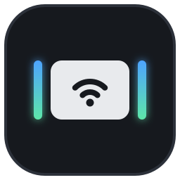

<div align="center">



# DS Buddy

**Pareia seu controle de PlayStation no Windows, mesmo com dongles teimosos.**

[](https://github.com/ndworks-dev/ds-buddy/actions/workflows/release.yml)


[](LICENSE)

**Encontra e pareia controles DualShock 4 e DualSense por Bluetooth. Feito em
Rust e Slint.**

[Instalar](#instalar) · [Uso](#uso) · [Compilar](#compilar) ·
[Releases](https://github.com/ndworks-dev/ds-buddy/releases) · [Apoie](#apoie)

</div>

Com alguns adaptadores, como os clones CSR8510 (`VID_0A12&PID_0001`), o controle
em modo de pareamento nunca aparece na tela **Adicionar dispositivo** do
Windows, ou aparece e falha na primeira tentativa. O DS Buddy usa a API clássica
de Bluetooth do Windows e insiste até parear. O "DS" vale para os dois:
**D**ual**S**hock e **D**ual**S**ense.

**Alfa.** Windows 10 ou 11, x64. Não precisa de administrador.

## Instalar

No PowerShell:

```powershell
irm https://ndworks.dev/ds-buddy/install.ps1 | iex
```

O script baixa a última release, confere o SHA-256, instala em
`%LOCALAPPDATA%\Programs\DS Buddy`, cria um atalho no menu Iniciar e abre o
app. O mesmo comando atualiza uma instalação existente.

Para instalar uma versão específica ou desinstalar:

```powershell
& ([scriptblock]::Create((irm https://ndworks.dev/ds-buddy/install.ps1))) -Version 0.2.0
& ([scriptblock]::Create((irm https://ndworks.dev/ds-buddy/install.ps1))) -Uninstall
```

Os controles pareados continuam pareados no Windows depois da desinstalação.

[](https://ndworks.dev/ds-buddy/download)

Prefere sem instalar? Baixe o `DS-Buddy-X.Y.Z-windows-x64.zip` da última
release, extraia e rode o `ds-buddy.exe`.

## Uso

### Parear

Coloque o controle em modo de pareamento e clique em **Procurar e parear**. Para
isso, segure **Create** (DualSense) ou **Share** (DualShock 4) junto com **PS**
até a luz piscar duas vezes seguidas, várias vezes. Se o Windows mostrar uma
janela ou notificação pedindo confirmação, aceite. O quadro **Atividade** mostra
cada busca e cada tentativa.

### Controles

Lista os controles que o Windows conhece.

- **Reparear** esquece o pareamento antigo e pareia de novo. Use quando o
  controle não conecta mais, por exemplo depois de usá-lo no PS5. Coloque-o em
  modo de pareamento antes.
- **Esquecer** remove o controle do Windows. Pede um segundo clique para
  confirmar.

Para reconectar um controle já pareado, basta apertar o botão PS.

## Como funciona

A tela de Configurações do Windows desiste rápido. O DS Buddy:

1. Faz buscas seguidas (~8 s cada) até achar um controle PlayStation, pelo nome
   ou pela classe de dispositivo "gamepad".
2. Chama o controle direto pelo endereço (`BluetoothAuthenticateDeviceEx`), sem
   depender da lista do Windows.
3. Se falhar, tenta de novo a cada 3 s, por até 10 minutos.
4. No sucesso, ativa o serviço HID do controle.

## Privacidade

O DS Buddy não envia telemetria nem acessa a rede. Ele não guarda
configurações próprias: os pareamentos ficam no Windows.

## Compilar

Instale o Rust (toolchain MSVC) e, na raiz do repositório:

```powershell
cargo test              # testes
cargo build --release   # target\release\ds-buddy.exe
```

A interface usa renderização por software, então não precisa de GPU nem de
WebView2. `scripts\make-icon.ps1` gera `ui\icon.png` e `icon.ico`. Para tirar
capturas de tela, `DS_BUDDY_PAGE=1` abre o app direto na aba Controles.

## Arquitetura

```
src/main.rs      ponto de entrada e ligação com a interface
src/bt.rs        chamadas à API de Bluetooth do Windows
src/pairing.rs   o fluxo de busca e pareamento, numa thread separada
ui/app.slint     a interface
ui/widgets.slint componentes da interface
scripts/         ícone, versão das releases e o script de instalação
```

## Releases

O `.github/workflows/release.yml` compila, roda o lint e os testes em todo push
e pull request. Quando um push no `main` tem commits que justificam uma release,
ele cria a tag `vX.Y.Z` e publica uma release no GitHub com:

- `DS-Buddy-X.Y.Z-windows-x64.zip`: o `ds-buddy.exe` e os textos das licenças
- `install.ps1`: o script de instalação
- `SHA256SUMS.txt`

A versão vem dos [Conventional Commits](https://www.conventionalcommits.org/)
desde a última tag (`scripts/release-version.sh`):

| Commits desde a última release | Próxima versão |
|---|---|
| uma mudança incompatível (`feat!:` ou rodapé `BREAKING CHANGE:`) | major; minor enquanto abaixo de 1.0 |
| pelo menos um `feat` | minor |
| `fix` ou `perf` | patch |
| só `docs`, `chore`, `ci`, `refactor`, `test`, `build` | sem release |

A primeira release usa a versão do `Cargo.toml`. Para pular para uma versão
específica, aumente a versão no `Cargo.toml`, porque uma versão manual maior
sempre vence. O CI grava a versão da release no executável, e o `Cargo.toml` em
si não muda com as releases. Não crie tags `v*` nem releases à mão.

O `scripts/install.ps1` é o que os usuários rodam com `irm | iex`. Ele precisa
continuar funcionando no Windows PowerShell 5.1, nunca pode chamar `exit` (isso
fecharia o shell do usuário) e precisa conferir o checksum antes de instalar.

## Apoie

O DS Buddy é gratuito. Se ele te ajudou, você pode apoiar o desenvolvimento no
Ko-fi.

[](https://ko-fi.com/nickolasdeluca)

## Licença

GPL-3.0-or-later (veja `LICENSE`). A interface usa o Slint sob a GPLv3.

As fontes IBM Plex são distribuídas sob a SIL Open Font License
(`ui\fonts\LICENSE.txt`).
